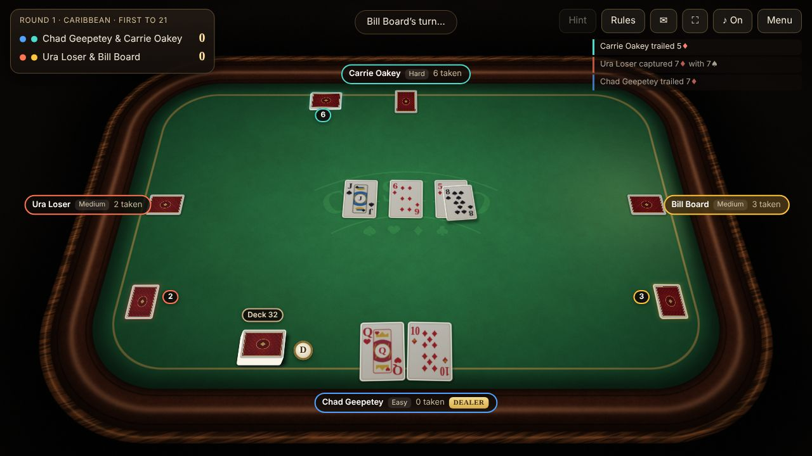

# Casino

The classic fishing card game **Casino** (also spelled *Cassino*), for 2–4 players against computer opponents. It runs in a browser as a single self-contained `index.html` of about 133 KB (about 48 KB gzipped).

Everything in the game is generated in code: the WebGPU-rendered table and cards, and the Web Audio sound effects. There are no image, font or audio files, no libraries, and no build step needed to play.

## Play

**Online:** open the GitHub Pages link for this repository.

**Locally:** download `index.html` and open it in Chrome or Edge.

Try online: [Live Demo](https://seven14.github.io/Casino)

The game needs a browser with **WebGPU**. It was developed and tested on Windows 11 with Chrome; recent Chrome and Edge on desktop and Android support it. Browsers without WebGPU show a message instead of the table.

On a phone, the **⛶** button hides the browser bars on Android. On iPhone and iPad, use *Share → Add to Home Screen* for a full-screen app.

## Features

- **Four variants:** Standard, Royal (the default), Caribbean and Spade. Each sets its own target score.
- **2, 3 or 4 players.** Four players can play as partners or every player for themselves.
- **Computer opponents** at Easy, Medium or Hard. Their names are drawn at random.
- **Watch mode:** four bots play each other.
- **Guided lessons** for Standard, Royal and Spade, played against Carol.
- **Rules reference** during play: the **Rules** button (or the R key) opens the rules for the current variant and pauses the game.
- **Undo** your last play (↶ or Ctrl+Z).
- **Hint** suggests a good move.
- **Manual capture:** you pick which table cards to take, so you can miss points just as at a real table. Turn on **Solver** in the menu to have your card take everything it can.
- **Taunt:** a giggle when one side steals the other side's build. Can be turned off.
- Traditional dealing, two cards at a time. A random first dealer, then the deal moves left each round.
- Three felt colors and three card backs. Settings are saved in the browser.
- **Tester feedback:** the ✉ button sends a comment, a screenshot and the full game state to a private GitHub repository. Testers don't need an account. See [Tester feedback](#tester-feedback).

## How to play

On your turn, play one card from your hand and do one of the following:

| Move | What it does |
|---|---|
| **Capture** | Take table cards that match your card: the same rank, loose cards that add up to its value, or a build of its value. Tap the cards you want, then drag your card onto them. |
| **Build** | Put your card on table cards to make a total you can capture next turn. You must hold a card of that value. |
| **Raise** | Add a card to a single build to make a bigger total, if you hold a card of the new total. |
| **Trail** | Lay your card face up on the table. Not allowed while you own a build. |

Clearing the table is a **sweep** (★), worth 1 point. Cards left on the table at the end of a round go to whoever captured last.

### Scoring

| | Standard / Royal / Caribbean | Spade |
|---|---|---|
| Most cards | 3 | 3 |
| Most spades | 1 | — |
| Each spade | — | 1 (J♠ and 2♠: 2 each) |
| 10♦ Big Casino | 2 | 2 |
| 2♠ Little Casino | 1 | (counted as a spade) |
| Each ace | 1 | 1 |
| Each sweep | 1 | 1 |
| **Target** | **21** | **61** |

A tie for most cards or most spades scores nothing for anyone.

### Variant differences

- **Standard:** Ace = 1, number cards are worth their face value. J, Q and K only capture their own rank. Builds go up to 10.
- **Royal:** J = 11, Q = 12 and K = 13, and they can be added and built like any card. Builds go up to 16. Three cards have a second value when you play them from your hand: an ace is 1 or 14, the 2♠ is 2 or 15, and the 10♦ is 10 or 16.
- **Caribbean:** the same as Royal without the second values: every card has one value (an ace is always 1). Builds go up to 13.
- **Spade:** played like Standard, but every spade scores points.

## Controls

| Action | Mouse / touch | Keyboard |
|---|---|---|
| Choose cards to capture | Tap them | — |
| Play a card | Drag it from your hand onto the table | — |
| Undo last play | ↶ Undo | Ctrl+Z |
| Rules | Rules | R |
| Send feedback | ✉ | — |
| Menu | Menu | Esc |

## URL options

These query parameters are mostly for testing and demos, for example `index.html?auto=watch&variant=spade`.

| Parameter | Effect |
|---|---|
| `auto=watch` / `auto=play` / `auto=tutorial` | Skip the menu and start watching, playing or a lesson |
| `lesson=standard\|royal\|spade` | Which lesson to start, used with `auto=tutorial` |
| `variant=standard\|royal\|caribbean\|spade\|mixed` | Variant for the started game (`mixed` rotates through all four) |
| `speed=N` | Game speed multiplier (0.25–50) |
| `seed=N` | Fixed random seed, so a game can be replayed exactly |
| `games=N` | In watch mode, stop after N games (used by the soak test) |
| `mute=1` | Start muted |
| `key=CODE` | Family feedback code. The game remembers it and removes it from the address bar. |

## Publish on GitHub Pages

1. Put `index.html`, this README, `screenshot.png`, `FEEDBACK_SETUP.md` and `feedback-worker.js` in the root of the repository.
2. On GitHub, open **Settings → Pages**. Under *Build and deployment*, choose **Deploy from a branch**, then select your main branch and the `/ (root)` folder.
3. After a minute the game is live at `https://<your-username>.github.io/<repository-name>/`.

GitHub Pages serves over HTTPS, which WebGPU requires.

## Tester feedback

Testers press **✉** (or **Menu → Send feedback**) and write what happened, and optionally their name. The game pauses while the dialog is open. Each report includes:
- a screenshot of the table;
- every hand, the table cards and builds;
- the variant, round, scores and dealer;
- the game's random seed and recent moves, so the game can be replayed;
- browser, device and graphics details, and any errors the game recorded.

Testers can see exactly what will be sent before pressing **Send**.

Reports go through a small Cloudflare Worker (`feedback-worker.js`), which files them as issues in a **private** GitHub repository. Testers need no account. The GitHub token stays inside the Worker, and a family code in the shared link keeps strangers out. An invisible Turnstile bot check, rate limits and strict input checks block abuse. Setup takes about 20 minutes in a browser: see **[FEEDBACK_SETUP.md](FEEDBACK_SETUP.md)**.

Until it's set up, the dialog offers **Save report**, which downloads the report as a file.

## Technical notes

- **Rendering:** WebGPU. The table is drawn once into a texture; cards are instanced quads with SDF rounded corners. The card faces are painted into a texture atlas with Canvas 2D when the game loads.
- **Audio:** Web Audio. Every sound is synthesized from noise and oscillators, including the room reverb.
- **Bots** run in a Web Worker, so they never stall the animation.
- **Frame loop:** allocation-free, using typed arrays for all per-frame state, so long sessions don't build up garbage-collection pauses.
- **Verification:** before release the game passed several-hour unattended soak runs and thousands of simulated bot matches across all three variants, with rule-invariant checks on every move.
